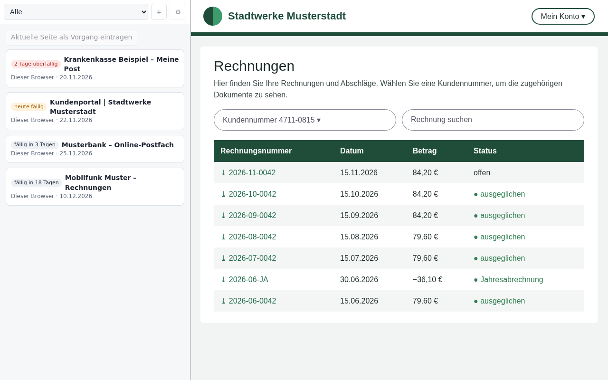

# portal-download

> [!IMPORTANT]
> **Warum es das gibt.** Rechnungen, Bescheide und Abrechnungen kommen bei vielen Unternehmen nicht mehr per Post oder E-Mail, sondern liegen nur noch in einem Portal, aus dem ich sie mir selbst holen muss. Das ist eine absolute Unart. Jedes Unternehmen hat sein eigenes Portal, ein einheitliches Verfahren gibt es nicht, und der einzige Grund, den ich mir dafür vorstellen kann, ist die Einbildung, so ließe sich die Zustellung beweisen. Mich nervt das gewaltig. portal-download löst das Problem nicht, es macht es für mich nur erträglicher, und zufrieden bin ich damit nicht. Die [GitHub-Diskussionen](https://github.com/schlingensiepen/portal-download-extension/discussions) sind offen und werden gelesen: Tragt dort bitte Erfahrungen, Wünsche, Verbesserungsvorschläge und Bugs ein.

> [!NOTE]
> **Why this exists.** Invoices, notices and statements from many companies no longer come by post or e-mail; they sit in a portal, and I have to fetch them myself. That is an utter bad habit. Every company has its own portal, there is no common procedure, and the only reason I can think of is the belief that this proves delivery. It annoys me enormously. portal-download does not solve the problem; it only makes it bearable for me, and I am not happy with it. The [GitHub discussions](https://github.com/schlingensiepen/portal-download-extension/discussions) are open and read: please post your experience, wishes, suggestions and bugs there.



portal-download is a workbench for a small, invited circle of people. They regularly have to download invoices, statements and other documents from web portals. It keeps the list of these portals and says which one is due.

It has two parts:

- **The service** keeps the jobs, the people and their access. You run it yourself in your intranet, from one container image. It includes a web application for working and for administration.
- **The browser extension** for Chrome, Edge and Firefox shows the due jobs in the browser's side panel, next to the portal. It works with several services at once, and also without any service. It is the recommended way of working and has [its own repository](https://github.com/schlingensiepen/portal-download-extension).

The portal logins are stored in plain text on the service, and every person of the circle sees them. The protection is the intranet, HTTPS and access by invitation.

## In a container

You need a machine with Docker that the circle's browsers reach on port 443.

1. Start the service. Replace `downloads.intra.example` with the host name or IPv4 address the browsers will use, and `Europe/Berlin` with your time zone.

   ```bash
   docker run -d --name portal-download --restart unless-stopped \
     -p 443:443 -v portal-download:/data \
     -e SITE=downloads.intra.example -e TZ=Europe/Berlin \
     ghcr.io/schlingensiepen/portal-download:0.9
   ```

2. Read the log. After a few seconds it ends with the ready block.

   ```bash
   docker logs portal-download
   ```

   ```text
   portal-download container: ****************************************************************
   portal-download container: *  SETUP NEEDED: nobody is set up yet
   portal-download container: ----------------------------------------------------------------
   portal-download container:    Open:                   https://downloads.intra.example/
   portal-download container:    Certificate authority:  SHA-256 <FINGERPRINT>
   portal-download container:                            trust it once: https://downloads.intra.example/ca.crt (compare first)
   portal-download container:    Setup secret:           pds_<SECRET>  (valid until <YYYY-MM-DD>T<hh:mm:ss>Z; enter it in the browser)
   portal-download container: ================================================================
   portal-download container: portal-download 0.9.0 is ready: https://downloads.intra.example/
   ```

3. Make your computer trust the service's certificate authority. [Certificates](docs/install.md#certificates) shows how, for Windows, macOS, Linux and Firefox. Until then the browser warns about the certificate.
4. Open the address from the block. Enter the setup secret and your name, and click **Create the first access**. This creates the first person, who holds all three rights.
5. The page **Accept the invitation** appears. Name the device and click **Accept the invitation in this browser**.
6. Create the first job, then invite the others under **People**.

The setup secret is valid for 30 minutes. `docker exec portal-download portal-download bootstrap` prints a fresh one.

## Documentation

| Page | For whom | What it holds |
|---|---|---|
| [docs/install.md](docs/install.md) | whoever sets the service up | other container runtimes, Docker Compose, a reverse proxy of your own, certificates, running without a container |
| [docs/using.md](docs/using.md) | everybody in the circle | the web application: jobs, the schedule, importing logins from Firefox, exchanging jobs as a file |
| [docs/operating.md](docs/operating.md) | whoever looks after the service | people, rights and roles, invitations, devices, agents, backup and restore |
| [docs/upgrading.md](docs/upgrading.md) | whoever looks after the service | the steps from one version to the next |
| [docs/reference.md](docs/reference.md) | operators, agents, developers | versions, commands, configuration, the ready block, the API |
| [docs/glossary.md](docs/glossary.md) | everybody | the words used on these pages |
| [The extension's README](https://github.com/schlingensiepen/portal-download-extension#readme) | everybody in the circle | installing and using the browser extension |

## Development

```sh
cargo test
```

[AGENTS.md](AGENTS.md) says how to work on this repository. [docs/reference.md](docs/reference.md#for-agents-and-scripts) describes the API.

## Safari

Ich bitte um Verständnis, dass ich für ein kleines Hobbyprojekt nicht in das Apple Developer Program investiere. Ich habe aber gehört, dass Firefox und Chrome sehr gut auf Apple-Geräten laufen.

*Please understand that I am not paying for the Apple Developer Program for a small hobby project. I have heard, though, that Firefox and Chrome run very well on Apple devices.*

## Edge Add-ons

Wegen der Unbenutzbarkeit des Microsoft Partner Center musste der Eintrag bei Edge Add-ons leider verschoben werden. Bis dahin lädt Edge die ZIP-Datei aus den Releases wie Chrome.

*Because the Microsoft Partner Center proved unusable, the listing on Edge Add-ons had to be postponed. Until then, Edge loads the ZIP file from the releases, as Chrome does.*

## License

Apache License 2.0, see [LICENSE](LICENSE).
